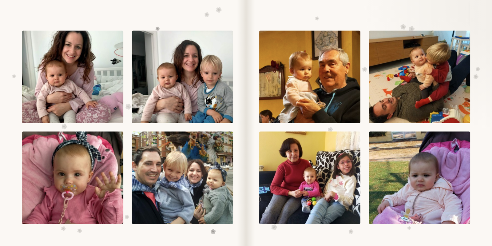
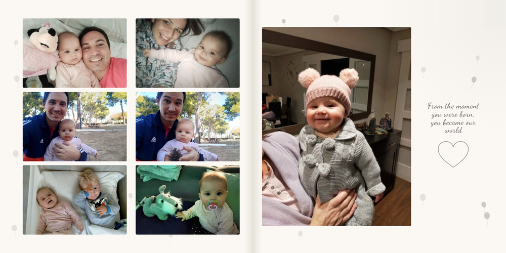
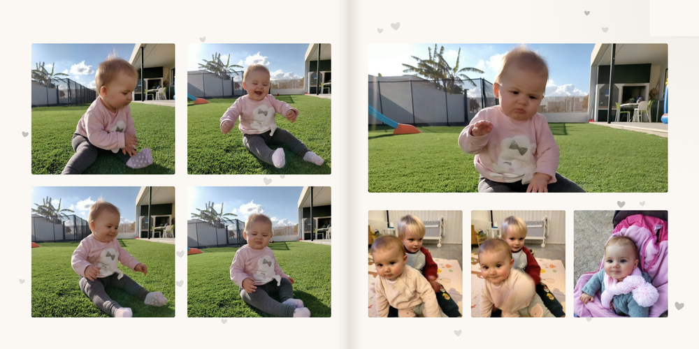

## A formula that always works

Write these four things, in this order, and you are done:

1. **Who it is for:** “To Mia,” or “Dear little one,”.
2. **Why this book:** you loved it as a kid, it was your own child's favorite, or it made you think of them.
3. **A wish:** one short line about reading, love or the life ahead.
4. **Who and when:** your name, your relationship and the full date. The date is the part people are glad of twenty years later.

## Short inscriptions

1. “May this be the first of many favorites. Love, Aunt Jo, June 2027.”
2. “For bedtime, and for every time after that when you ask for it again.”
3. “Read this one twice. It gets better. Love, Sam.”
4. “Welcome to the world, and to all its stories.”
5. “Every great reader starts with one book. Here is yours.”
6. “Made for small hands and sleepy parents.”

## From friends of the parents

7. “Your mom and I read this in a tent when we were nine. Now it's your turn.”
8. “I have known your dad for fifteen years, and he still can't do the voices. Ask him anyway.”
9. “This book got my kids through the hard nights. May it do the same for your parents.”
10. “We can't wait to meet you. We have been hearing about you for months.”

## From grandparents

11. “I read this to your father in the same chair where I hope to read it to you.”
12. “This was your mom's favorite. She knew every word before she could read. Love always, Grandma.”
13. “Bring this book to my house, and I will read it as many times as you like.”
14. “You made us grandparents. This is the first of many things we plan to spoil you with.”

## From aunts and uncles

15. “For the days you need someone other than your parents to read to you. Call me.”
16. “I'm the fun one. This book proves it. Love, Uncle Theo.”
17. “I have held your mom's hand all her life. I'm ready to hold yours.”
18. “When you are old enough, ask me what your dad was like at your age. Until then, enjoy the book.”

## A little funny

19. “Sorry in advance to your parents. You are going to want this one every single night.”
20. “Warning: contains a very catchy rhyme. Your parents will be reciting it in their sleep.”
21. “Yes, you may chew on this. It's a tradition.”
22. “Your first review is due in about three years. No pressure.”

## More heartfelt

23. “You were loved long before you could read this, and you will be loved long after you know it by heart.”
24. “I hope you grow up to find yourself in many books, and that this was one of the first.”

## If you don't know the family well

Stick to the book. Say why you picked it, wish them well and sign with your full name and how you know the parents. “From Dana, who works with your mom and loved this book as a kid” is warm, honest and useful to a child reading it years from now.

## If you meant the baby's own book

Maybe you landed here with a different question: not a gift, but what to put in your baby's own first-year book. In that case, short lines work there too. A date, a nickname or the song that stopped the crying is enough, and you will find more examples in our [baby photo book ideas](page:ideas).

If the writing is what keeps you from starting, [a first year photo book](page:firstYear) can come first. BabyBookAI lays the book out from the photos on your phone, and you add only the words you want before you order.

<small>Cover photo: Direct Media, CC0 (StockSnap), as an example. The book spreads are pages laid out by BabyBookAI from the family’s own photos.</small>
