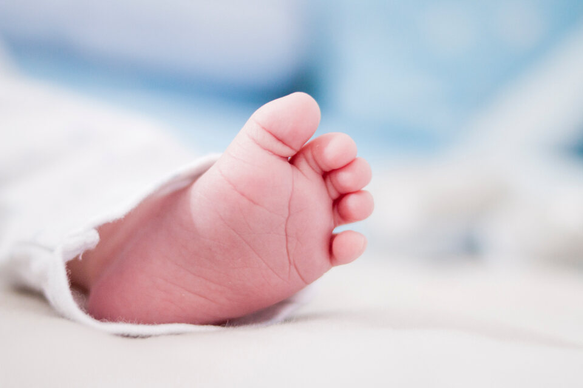
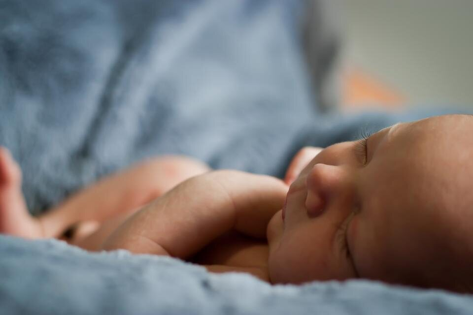
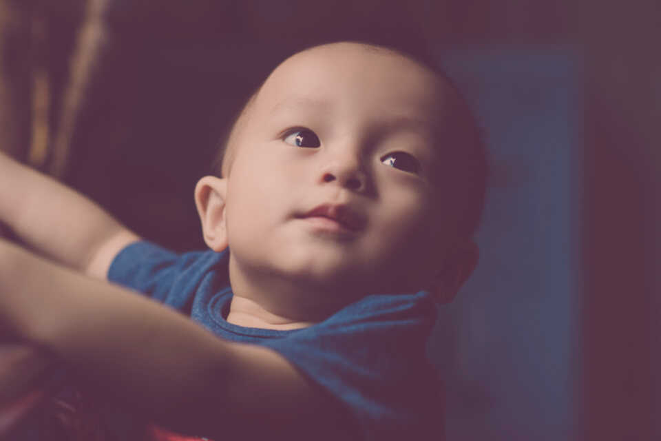
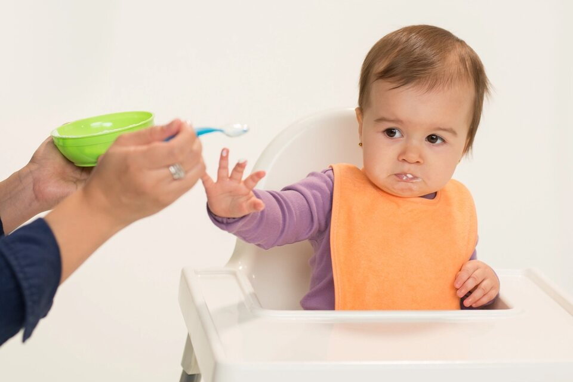
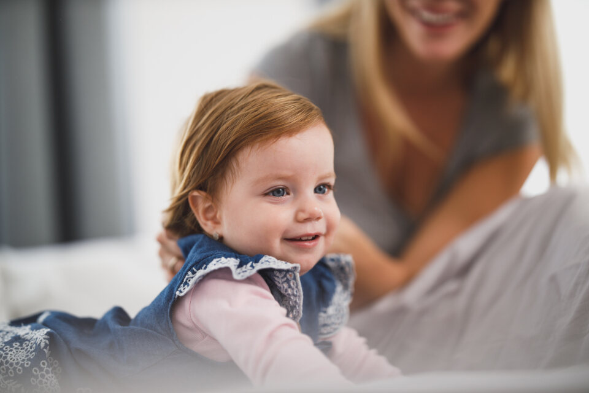
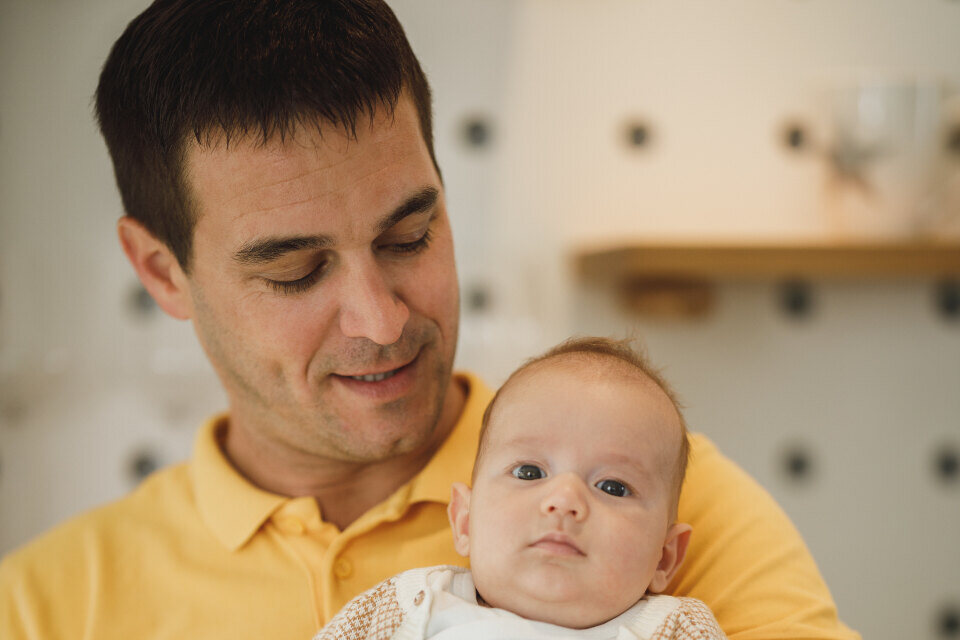
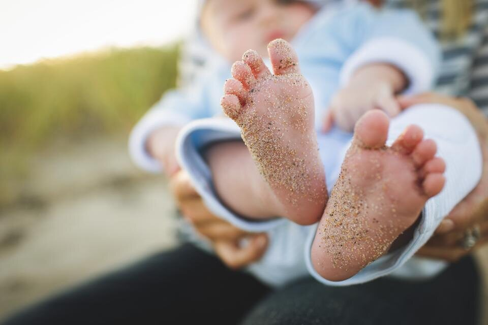
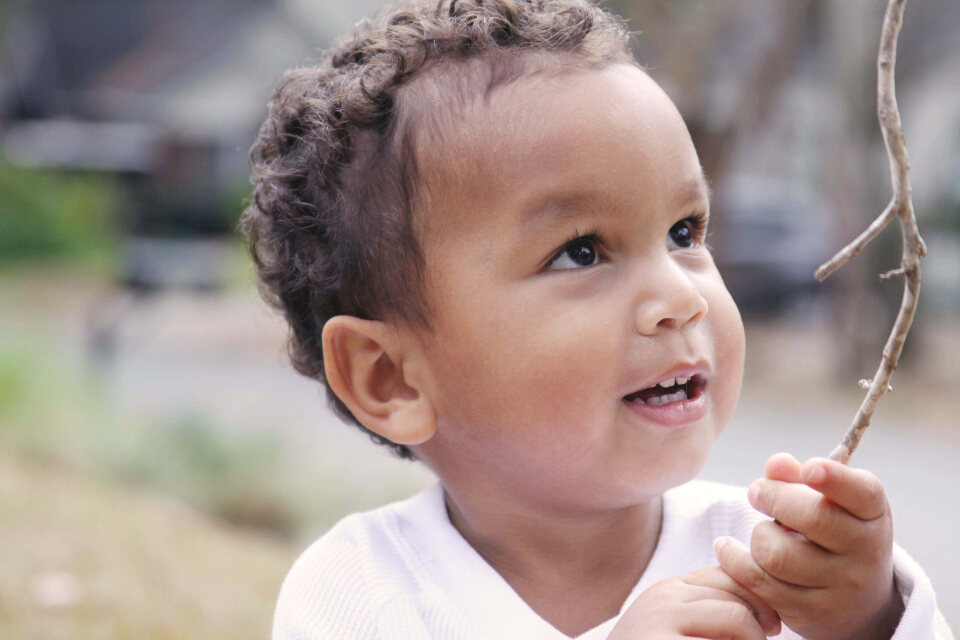
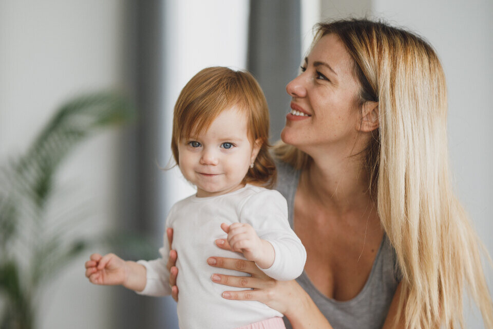
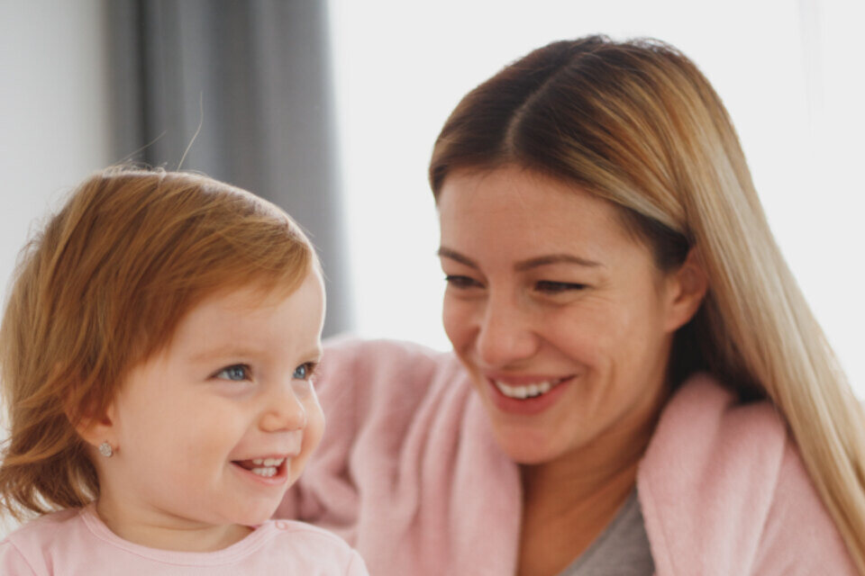

## Antes de empezar: lo que hace que la serie funcione

Estas cuatro costumbres importan más que cualquier idea de la lista:

- **Busca la luz de una ventana.** De lado o de frente, nunca a contraluz, y sin flash. La luz de la mañana es la más fácil.
- **Repite algo.** La misma manta, el mismo muñeco o el mismo rincón hacen que, puestas en fila, las fotos cuenten cuánto ha crecido.
- **Baja el móvil a su altura.** Desde arriba todos los bebés parecen más pequeños y más lejos.
- **Hazla cuando esté contento.** Después de dormir y de comer. Si llora, se deja para mañana.

Y una norma que va antes que la foto: no lo dejes solo ni un segundo sobre una cama, una mesa o un sofá, y no pongas a su alcance nada pequeño que pueda llevarse a la boca. Si el atrezo no es seguro, la foto no lo necesita.

## Doce ideas, una para cada mes

Cada bebé va a su ritmo. Si la idea de un mes todavía no le toca, o ya se le ha pasado, cámbiala por otra de la lista.

### Mes 1: el pie, que cabe en tu mano

Hoy no hace falta ni que esté despierto. Un pie contra la palma de tu mano es la foto que más te sorprenderá dentro de un año, porque esa diferencia de tamaño ya no vuelve.

### Mes 2: dormido sobre la manta de siempre

Duerme mucho, así que aprovéchalo: es el único modelo que no se mueve. Elige ya la manta que vas a repetir y haz la foto desde cerca, a su altura.

### Mes 3: en brazos, con quien lo sostiene

A los tres meses muchos bebés sostienen mejor la cabeza y miran al frente. Pasa el móvil a alguien y salid juntos: en esas fotos que nadie hace es donde estás tú.

### Mes 4: la mirada hacia la luz

Empieza a seguir lo que se mueve. Túmbalo cerca de la ventana y llama su atención con la voz o con un juguete sin luces. Hazla desde su lado, sin flash: los ojos hacen el resto.

### Mes 5: en el aire, sobre quien está tumbado

Cuando ya sujeta bien la cabeza, túmbate en la alfombra y levántalo un poco, despacio y sin soltarlo. Que otra persona haga la foto de lado, con la habitación entera. Una foto amplia entre tantos primeros planos se agradece.

### Mes 6: la primera comida, con su desastre

Sobre esta edad suele llegar la primera papilla. Olvídate de la cara limpia: la cuchara, el babero manchado y el gesto de «qué es esto» son la foto.

### Mes 7: boca abajo, con la cabeza bien alta

Sobre la manta de siempre y con alguien detrás. Baja hasta el suelo y ponte delante, a la altura de sus ojos: desde ahí, un bebé que levanta la cabeza parece el dueño de la casa.

### Mes 8: con las personas de casa

Hermanos, abuelos, el padre que nunca sale en las fotos. Que lo coja cada uno y haced una por persona. Son las que buscará cuando sea mayor.

### Mes 9: los pies otra vez, ya con historia

Vuelve a la foto del primer mes. Ahora los pies tienen arena, hierba o el calcetín que siempre pierde. Puestas juntas, esas dos fotos valen por toda la serie.

### Mes 10: la cara de cuando descubre algo

Dale algo que no conozca, una rama, una hoja, una cuchara de madera, sin perderlo de vista. Dispara varias seguidas mientras lo investiga. La buena suele ser la que nadie esperaba.

### Mes 11: de pie, agarrado a unas manos

Muchos bebés se ponen de pie agarrados a algo por estas fechas. Sujétalo por detrás, sin soltarlo, y haz la foto bajando el móvil a su altura, para que se vea el esfuerzo.

### Mes 12: tú y el bebé, con el año en la cara

La última no tiene que ser la tarta. Una foto de los dos riéndoos cierra el año mejor que cualquier decorado, y la tarta ya saldrá sola en la fiesta. Saca también la del rincón de siempre, para cerrar la serie.

## Cómo poner el número del mes

No hace falta poner nada: la fecha está en la foto y, en un álbum, el mes se escribe en la página. Si te gusta verlo:

- **Una hoja escrita a mano**, junto a él y sin que pueda alcanzarla. Tu letra envejece mejor que una tipografía.
- **Números grandes de cartón o de madera**, siempre que no quepan en la boca.
- **El mismo muñeco al lado.** No lleva número, pero enseña mejor que ninguno lo que ha crecido.

## Y luego, ¿qué haces con esas doce fotos?

Lo normal es que se queden en el móvil, mezcladas con miles de fotos más. Para no perderlas, márcalas como favoritas el mismo día: un minuto ahora ahorra una tarde dentro de un año.

Si quieres verlas en papel, puedes hacer un [álbum del primer año, mes a mes](page:firstYear). BabyBookAI lo hace con las fotos que ya tienes en el móvil: las lee en tu teléfono, se queda con la más nítida de cada momento y le da a cada mes su doble página. Tú lo revisas y lo recibes en casa, impreso y en tapa dura, por {price} con el envío incluido. Y si no hiciste la foto de algún mes, o de ninguno, el álbum sale igual con las que ya tienes.

Si te faltan ideas para el resto de páginas, tienes más en [ideas para el álbum del bebé](page:ideas).

<small>Fotografías de archivo con licencia CC0 (StockSnap y rawpixel), como ejemplo de cada idea.</small>
